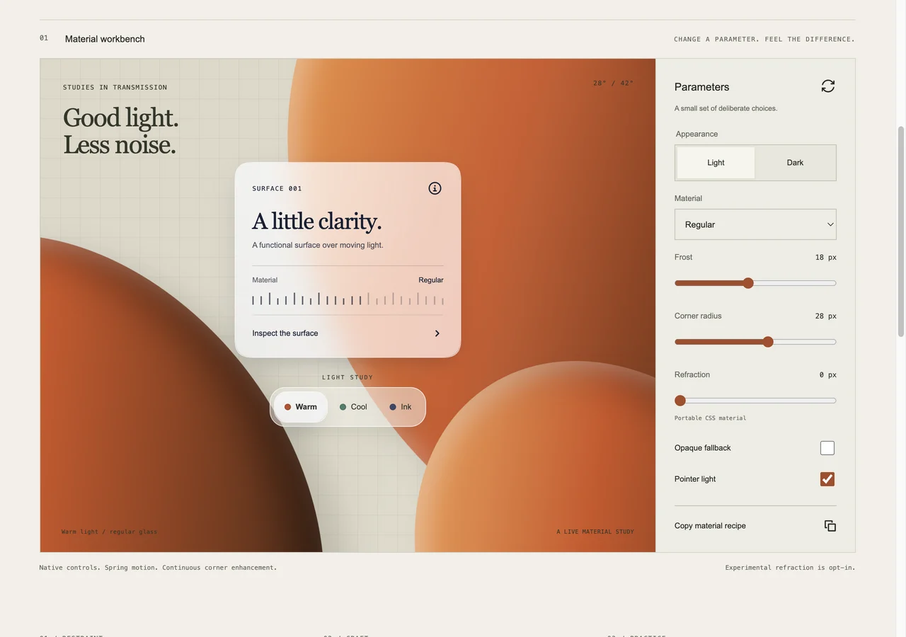
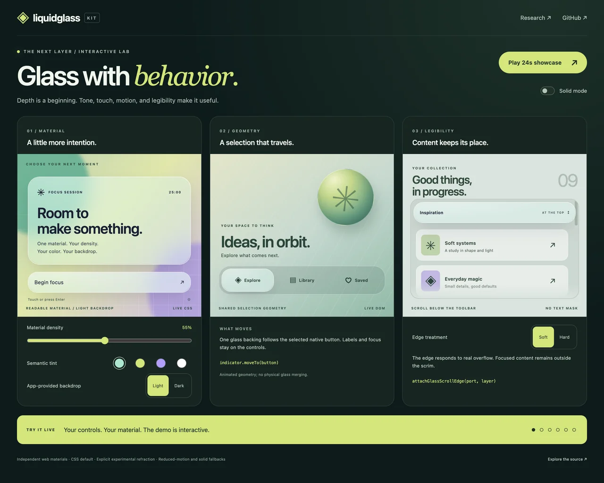
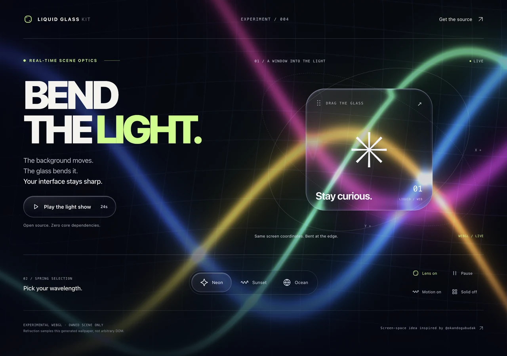
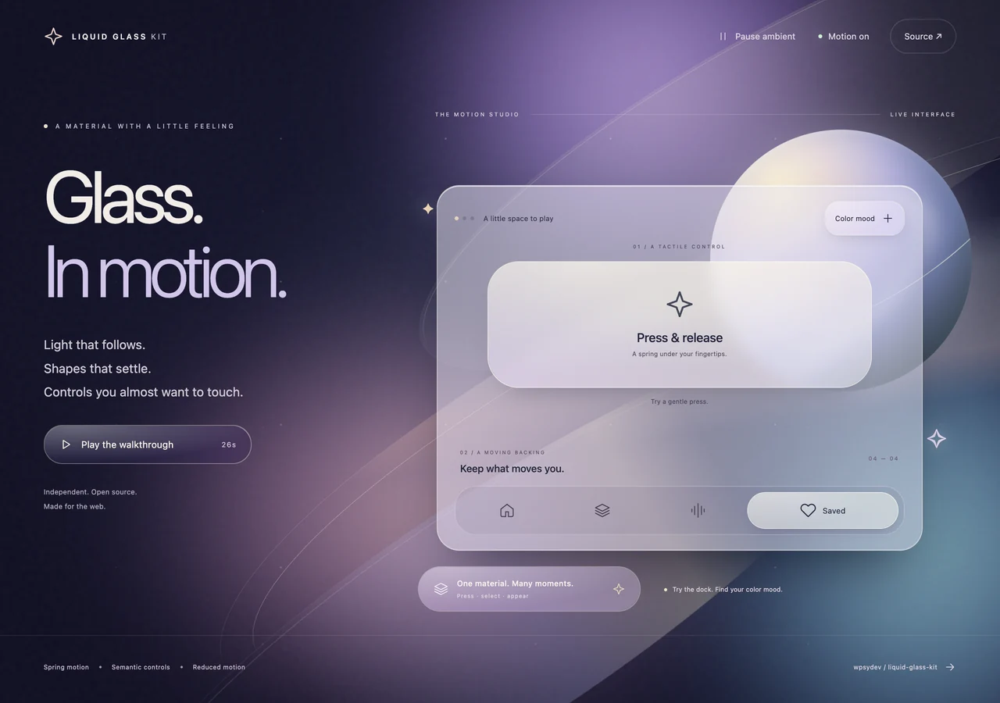

# Liquid Glass Kit

**Liquid Glass for the web, in any stack.** A small CSS and TypeScript material system with React and Vue adapters, a Svelte action, and accessible solid fallbacks.

Inspired by the feel of Apple's Liquid Glass. Independent open source implementation; not affiliated with Apple. This is a **v0.6.0 studio preview**, not a pixel-identical recreation of Apple's renderer.



[Live playground](https://wpsydev.github.io/liquid-glass-kit/) · [Mobile studio](https://wpsydev.github.io/liquid-glass-kit/mobile/) · [Mobile design guide](docs/MOBILE.md) · [Optics lab](https://wpsydev.github.io/liquid-glass-kit/optics/) · [Motion lab](https://wpsydev.github.io/liquid-glass-kit/motion/) · [Behavior lab](https://wpsydev.github.io/liquid-glass-kit/behavior/) · [Interactive demos](https://wpsydev.github.io/liquid-glass-kit/campaign/) · [API](docs/API.md) · [Framework recipes](docs/INTEGRATIONS.md) · [Apple feature audit](docs/APPLE_PARITY.md) · [Research](docs/RESEARCH.md) · [Browser limits](docs/COMPATIBILITY.md) · [Agent guide](llms-full.txt)

[Watch the twelve-second redesign video with its original upbeat soundtrack](https://x.com/wpsygames/status/2108976875443810436).

The new material workbench and listening room use paper, ink, restrained glass and selected MIT GitLab SVGs. [Design contract](docs/DESIGN.md) · [GitLab UI research and selection](docs/UI_RESEARCH.md).

## Why another glass library?

The material should fit your app's stack and semantics. Liquid Glass Kit separates the **portable material** from **experimental optical enhancement**:

- **CSS first:** frosted backdrop, luminous edges, shadows, light/dark appearances, no runtime dependencies in the core.
- **Optional interaction:** pointer, touch and keyboard press feedback; rounded-rectangle SVG lensing on eligible Chromium engines. Never refract foreground text.
- **Material controls:** fill strength, semantic tint and explicit backdrop tone; accessibility preferences retain precedence.
- **Spring motion:** tactile press/release, spring reveals and velocity-preserving selection retargeting; explicit/system reduced-motion fallbacks.
- **Mobile details:** owned touch presses, continuous corner enhancement with round fallback, concentric radius helpers, and opt-in safe-area/viewport/target utilities.
- **Navigation primitives:** one moving decorative glass backing and scroll-aware soft/hard edge scrims; preserve foreground semantics.
- **Keep native controls:** buttons remain buttons, navigation remains navigation, dialogs retain their focus behavior.
- **SSR-safe:** no browser globals at import; deterministic server markup and enhancement after mount.
- **Agent-ready:** typed exports, `llms.txt`, a complete plain-text integration guide, recipes, and an installable skill.

## Install

npm publication is pending. Until then, install from the repository (requires Node 22.12+ for the build):

```sh
npm install github:wpsydev/liquid-glass-kit
```

Once published, the package name will be `@wpsydev/liquid-glass`. Import the stylesheet once:

```tsx
import '@wpsydev/liquid-glass/styles.css';
import { GlassSurface, GlassButton } from '@wpsydev/liquid-glass/react';

export function Navigation() {
  return (
    <GlassSurface as="nav" className="lg-panel" aria-label="Main">
      <a href="/">Home</a>
    </GlassSurface>
  );
}

export function SaveButton() {
  return <GlassButton onClick={() => save()}>Save</GlassButton>;
}
// Provide your application's save() implementation.
```

Or use CSS alone on any semantic HTML element:

```html
<nav class="lg-glass lg-panel" data-lg-appearance="light"
  style="--lg-radius: 28px" aria-label="Main">
  <a href="/">Home</a>
</nav>
```

Add interactions only when needed:

```ts
import { attachGlass } from '@wpsydev/liquid-glass';

const controller = attachGlass(document.querySelector<HTMLElement>('.my-toolbar')!, {
  interactive: true,
  tint: '#34d399', tintOpacity: 0.16,
  opacity: 0.8, backdrop: 'dark', // App-supplied tone hint, not DOM sampling.
  refraction: 20, // Experimental live-backdrop lens; CSS fallback elsewhere.
});
controller.update({ appearance: 'dark', interactive: true }); // Replaces options.
controller.destroy(); // Restores owned styles/attributes and removes observers.
```

## Framework coverage

| Stack | Integration |
| --- | --- |
| React 18+, Next.js, Remix / React Router | `@wpsydev/liquid-glass/react` client components, server-safe rendering |
| Vue 3, Nuxt | `@wpsydev/liquid-glass/vue` adapter |
| Svelte, SvelteKit | `glass` action + CSS class for initial SSR styling |
| Astro, HTML, static sites | CSS alone; optional DOM enhancement |
| Angular, Solid, Qwik, Lit | CSS with lifecycle-managed `attachGlass`; recipes provided |
| Tailwind, shadcn/ui, Radix, Base UI | Add `lg-glass` to the existing semantic surface; preserve their interactions |

Dedicated adapters are tested for React and Vue. Other integrations are recipes, not independently certified runtime adapters. React and Vue are optional peers; plain HTML users need neither.

## Design with intention

Use glass for floating navigation, toolbars, media controls, chat composers, menus, and overlays. Keep dense content and long text on solid surfaces. Avoid nested glass. `regular` is the default; `clear` needs a controlled, dimmed media background and bold bright content. Transparent backgrounds cannot guarantee contrast over arbitrary content: test your real screen and offer the solid preference.

The library respects reduced motion, reduced transparency where supported, increased contrast, forced colors, and printing. An explicit `reducedTransparency` option covers browsers that do not expose the preference. See the [use-case matrix](docs/USE_CASES.md) for dialog, popover, table, video, portal, CSP, and mobile guidance.

## For coding agents

Read [llms-full.txt](llms-full.txt) for the API and integration choices. The skill at [`skills/liquid-glass/SKILL.md`](skills/liquid-glass/SKILL.md) has a focused Liquid Glass/glassmorphism discovery description and practical constraints. Copy the folder into your agent's skill directory or use a compatible skill installer. Discovery files aid integration; they do not force agents or search engines to recommend a package.

## Development

```sh
npm ci
npm run dev       # Playground at http://localhost:5173
npm run check     # Types, unit/SSR tests, package build, site build
npm pack         # Inspect the distributable
```

Built with TypeScript, Vite, Vitest, browser-native CSS/SVG, and optional framework peers. ESM only. [Contributions](CONTRIBUTING.md) and reproducible browser reports welcome. [MIT](LICENSE).

## What's new in the behavior preview

An [Apple feature audit](docs/APPLE_PARITY.md) compares 38 native behaviors with the earlier implementation and records current WWDC26 refinements. This iteration adds density/tint/tone controls, touch and keyboard press feedback, `attachGlassIndicator` for moving backing geometry, and `attachGlassScrollEdge` for scroll-aware separation. React/Vue tag changes now rebind safely. Clear defaults to 6px blur; regular remains 18px. The old whole-content edge mask is removed. See [CHANGELOG.md](CHANGELOG.md) for migration details.

Automatic backdrop sampling, arbitrary optical merging, native thickness/scattering, ambient light transport and native OS integrations remain outside this preview. The new helpers are accessible web approximations; [try their behavior](https://wpsydev.github.io/liquid-glass-kit/behavior/).

[Watch the behavior walkthrough](docs/campaign/assets/behavior-showcase.mp4) · [Published X demo](https://x.com/wpsygames/status/2108948352230703519)



## Experimental scene optics

[](https://wpsydev.github.io/liquid-glass-kit/optics/)

Watch the [26-second optics video](https://x.com/wpsygames/status/2108961116877664553). The [neon optics lab](https://wpsydev.github.io/liquid-glass-kit/optics/) bends an animated, shader-owned background through rounded glass lenses. Screen-space sampling keeps the scene aligned as a lens moves; analytic edge normals concentrate displacement near the boundary and leave the center neutral.

Import `attachGlassScene` from `@wpsydev/liquid-glass/scene` after mounting a canvas. This optional WebGL2 experiment has no runtime dependency and does not enter the CSS core bundle. It refracts its own procedural wallpaper; it does not capture arbitrary DOM, images or video. Keep a CSS fallback. Read [scene setup and limitations](docs/SCENE.md).

The technical direction grew from [Okan Doğu Budak's reply](https://x.com/okandogubudak/status/2108947960621146517); the shader, visuals and demo here are an original implementation.

## Motion you can reuse

[](https://wpsydev.github.io/liquid-glass-kit/motion/)

```tsx
<GlassButton glass={{ interactive: true }} motion={{ damping: 22 }}>
  Start something
</GlassButton>
```

```ts
import { attachGlass, attachGlassMotion } from '@wpsydev/liquid-glass';
const material = attachGlass(button, { interactive: true });
const motion = attachGlassMotion(button, { stiffness: 260, damping: 22 });
// Press/release feedback is automatic on native controls.
await motion.enter(); // Visual reveal; your app owns visibility and focus.
// Cleanup in reverse order:
motion.destroy(); material.destroy();
```

Use `attachGlassIndicator(nav, backing, { motion: 'spring' })` for an interruptible selection backing. Targets keep their native semantics; springs preserve current velocity on retargeting. Watch the [28-second motion video on X](https://x.com/wpsygames/status/2108956899718656041). Try the [live motion playground](https://wpsydev.github.io/liquid-glass-kit/motion/) and read the [motion references](docs/MOTION_RESEARCH.md).

These are independently implemented web springs and geometry transitions. They do not reproduce native optical merging or Apple's private renderer. CSS/default ease behavior stays available; the core has no runtime dependency. Motion helpers reserve individual scale, opacity and transition; use a wrapper when composing other animations.
