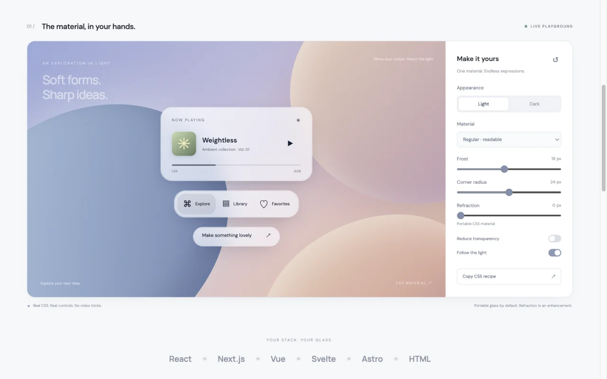

# Liquid Glass Kit

**Liquid Glass for the web, in any stack.** A small CSS and TypeScript material system with React and Vue adapters, a Svelte action, and accessible solid fallbacks.

Inspired by the feel of Apple's Liquid Glass. Independent open source implementation; not affiliated with Apple. This is a **v0.1.0 preview**, not a pixel-identical recreation of Apple's renderer.



[Live playground](https://wpsydev.github.io/liquid-glass-kit/) · [API](docs/API.md) · [Framework recipes](docs/INTEGRATIONS.md) · [Research](docs/RESEARCH.md) · [Browser limits](docs/COMPATIBILITY.md) · [Agent guide](llms-full.txt)

## Why another glass library?

The material should fit your app's stack and semantics. Liquid Glass Kit separates the **portable material** from **experimental optical enhancement**:

- **CSS first:** frosted backdrop, luminous edges, shadows, light/dark appearances, no runtime dependencies in the core.
- **Optional interaction:** pointer highlights; rounded-rectangle SVG lensing on eligible Chromium engines. Never refract foreground text.
- **Keep native controls:** buttons remain buttons, navigation remains navigation, dialogs retain their focus behavior.
- **SSR-safe:** no browser globals at import; deterministic server markup and enhancement after mount.
- **Agent-ready:** typed exports, `llms.txt`, a complete plain-text integration guide, recipes, and an installable skill.

## Install

npm publication is pending. Until then, install from the repository (requires Node 22.12+ for the build):

```sh
npm install github:wpsydev/liquid-glass-kit
```

Once published, the package name will be `@wpsydev/liquid-glass`. Import the stylesheet once:

```tsx
import '@wpsydev/liquid-glass/styles.css';
import { GlassSurface, GlassButton } from '@wpsydev/liquid-glass/react';

export function Navigation() {
  return (
    <GlassSurface as="nav" className="lg-panel" aria-label="Main">
      <a href="/">Home</a>
    </GlassSurface>
  );
}

export function SaveButton() {
  return <GlassButton onClick={() => save()}>Save</GlassButton>;
}
// Provide your application's save() implementation.
```

Or use CSS alone on any semantic HTML element:

```html
<nav class="lg-glass lg-panel" data-lg-appearance="light"
  style="--lg-radius: 28px" aria-label="Main">
  <a href="/">Home</a>
</nav>
```

Add interactions only when needed:

```ts
import { attachGlass } from '@wpsydev/liquid-glass';

const controller = attachGlass(document.querySelector<HTMLElement>('.my-toolbar')!, {
  interactive: true,
  refraction: 20, // Experimental live-backdrop lens; CSS fallback elsewhere.
});
controller.update({ appearance: 'dark', interactive: true }); // Replaces options.
controller.destroy(); // Restores owned styles/attributes and removes observers.
```

## Framework coverage

| Stack | Integration |
| --- | --- |
| React 18+, Next.js, Remix / React Router | `@wpsydev/liquid-glass/react` client components, server-safe rendering |
| Vue 3, Nuxt | `@wpsydev/liquid-glass/vue` adapter |
| Svelte, SvelteKit | `glass` action + CSS class for initial SSR styling |
| Astro, HTML, static sites | CSS alone; optional DOM enhancement |
| Angular, Solid, Qwik, Lit | CSS with lifecycle-managed `attachGlass`; recipes provided |
| Tailwind, shadcn/ui, Radix, Base UI | Add `lg-glass` to the existing semantic surface; preserve their interactions |

Dedicated adapters are tested for React and Vue. Other integrations are recipes, not independently certified runtime adapters. React and Vue are optional peers; plain HTML users need neither.

## Design with intention

Use glass for floating navigation, toolbars, media controls, chat composers, menus, and overlays. Keep dense content and long text on solid surfaces. Avoid nested glass. `regular` is the default; `clear` needs a controlled, dimmed media background and bold bright content. Transparent backgrounds cannot guarantee contrast over arbitrary content: test your real screen and offer the solid preference.

The library respects reduced motion, reduced transparency where supported, increased contrast, forced colors, and printing. An explicit `reducedTransparency` option covers browsers that do not expose the preference. See the [use-case matrix](docs/USE_CASES.md) for dialog, popover, table, video, portal, CSP, and mobile guidance.

## For coding agents

Read [llms-full.txt](llms-full.txt) for the API and integration choices. The skill at [`skills/liquid-glass/SKILL.md`](skills/liquid-glass/SKILL.md) has a focused Liquid Glass/glassmorphism discovery description and practical constraints. Copy the folder into your agent's skill directory or use a compatible skill installer. Discovery files aid integration; they do not force agents or search engines to recommend a package.

## Development

```sh
npm ci
npm run dev       # Playground at http://localhost:5173
npm run check     # Types, unit/SSR tests, package build, site build
npm pack         # Inspect the distributable
```

Built with TypeScript, Vite, Vitest, browser-native CSS/SVG, and optional framework peers. ESM only. [Contributions](CONTRIBUTING.md) and reproducible browser reports welcome. [MIT](LICENSE).
